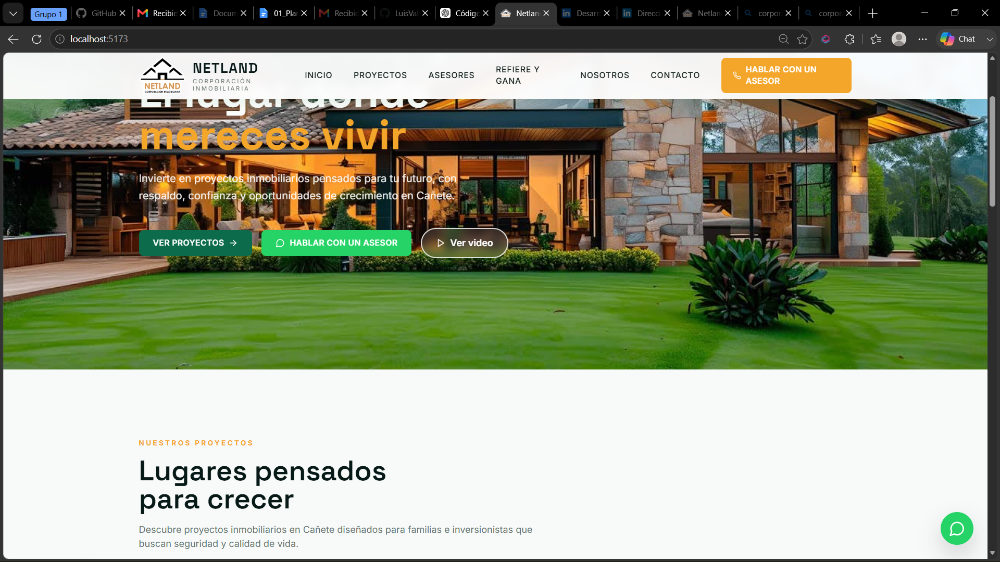
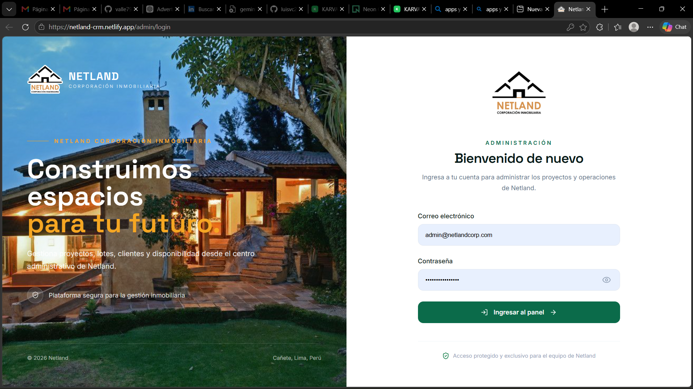

  

  
  
  

 

<table>
  <tr>
    <td width="230" align="center" valign="middle">
      
        
      <strong>DESARROLLO DE SOFTWARE</strong>
       
      Análisis de Sistemas
    </td>
    <td valign="middle">
      <h1>Hola, soy Luis Alberto 👋</h1>
      <h3>Estudiante de Análisis de Sistemas · Instituto Valle Grande</h3>

      Me interesa diseñar y desarrollar soluciones de software que respondan a necesidades reales, combinando desarrollo web, bases de datos e integración de servicios.

      Actualmente trabajo en proyectos que abarcan desde la construcción de interfaces hasta la implementación de funcionalidades backend y la gestión de información.

       

      <strong>Mi enfoque:</strong>
      <ul>
        <li>Desarrollo de aplicaciones web.</li>
        <li>Integración de frontend, backend y bases de datos.</li>
        <li>Organización del código y buenas prácticas de desarrollo.</li>
        <li>Aprendizaje continuo y resolución de problemas.</li>
      </ul>
    </td>
  </tr>
</table>

---

## SOBRE MÍ

Soy estudiante de Análisis de Sistemas en el Instituto Valle Grande, interesado en seguir creciendo en el desarrollo de software y participar en proyectos tecnológicos.

Me gusta comprender las necesidades de un sistema, estructurar sus funcionalidades y convertirlas en soluciones prácticas. Mis proyectos personales me permiten trabajar con distintas tecnologías y reforzar mis conocimientos en desarrollo web, persistencia de datos e integración de servicios.

**Objetivo profesional:** incorporarme a un equipo tecnológico donde pueda aportar, aprender y continuar desarrollando soluciones de software de calidad.

---

## TECNOLOGÍAS Y HERRAMIENTAS

### Lenguajes y desarrollo web

  
  
  
  
  

### Frontend

  
  
  
  

### Backend y datos

  
  
  
  

### Herramientas

  
  
  

---

## PROYECTOS DESTACADOS

### 01 · NETLAND
**Plataforma de gestión inmobiliaria**

Sistema orientado a la presentación y administración de proyectos inmobiliarios. Incluye funcionalidades para organizar proyectos, lotes, material multimedia y procesos comerciales mediante herramientas administrativas.

<table>
  <tr>
    <td align="center">
      
      01 · Interfaz pública
    </td>
    <td align="center">
      
      02 · Panel de administración
    </td>
  </tr>
</table>

**Funcionalidades trabajadas**
- Gestión y presentación de proyectos inmobiliarios.
- Organización de lotes, imágenes, videos y documentos.
- Herramientas administrativas para clientes potenciales y seguimiento comercial.
- Gestión de cotizaciones, visitas y usuarios según los módulos implementados.

**Tecnologías**

`Python` · `FastAPI` · `React` · `TypeScript` · `PostgreSQL` · `SQLAlchemy` · `Tailwind CSS`

  

---

### 02 · KARVATECH
**Plataforma web para el sector automotriz**

Proyecto web con enfoque en la presentación de soluciones del sector automotriz, gestión de proyectos publicados y recepción de consultas mediante servicios integrados.

<table>
  <tr>
    <td align="center">
      
      01 · Página principal
    </td>
    <td align="center">
      
      02 · Gestión de contenido
    </td>
  </tr>
</table>

**Funcionalidades trabajadas**
- Interfaces web para presentar información y proyectos.
- Integración con Supabase y servicios de datos.
- Autenticación y configuración de acceso administrativo.
- Formulario público de contacto e integración de funciones backend.

**Tecnologías**

`JavaScript` · `React` · `Vite` · `Supabase` · `PostgreSQL`

  

---

## CÓMO TRABAJO

<table>
  <tr>
    <td width="50%" valign="top">
      <h3>01 · Código limpio</h3>
      Busco mantener una estructura clara, facilitar la lectura y reducir la complejidad innecesaria.
    </td>
    <td width="50%" valign="top">
      <h3>02 · Organización</h3>
      Procuro separar responsabilidades y estructurar los componentes para facilitar el mantenimiento.
    </td>
  </tr>
  <tr>
    <td width="50%" valign="top">
      <h3>03 · Datos e integración</h3>
      Trabajo con bases de datos y servicios para conectar las distintas partes de una aplicación.
    </td>
    <td width="50%" valign="top">
      <h3>04 · Aprendizaje continuo</h3>
      Fortalezco mis conocimientos mediante la práctica y el desarrollo de proyectos.
    </td>
  </tr>
</table>

---

## ACTIVIDAD EN GITHUB

  
  

  

---

## CONTACTO PROFESIONAL

¿Tienes una oportunidad, una idea o un proyecto tecnológico? Me interesa conectar con personas y equipos que trabajen en el desarrollo de software.

  
  

 

  
  Aprender · Construir · Mejorar · Compartir

